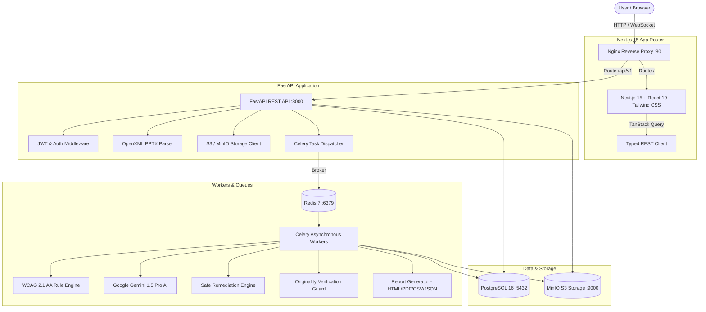

# AccessPPT — AI-Powered PowerPoint Accessibility Checker

> **“Make PowerPoint accessible — without changing your original presentation.”**

[](https://www.w3.org/WAI/WCAG21/quickref/)
[](https://www.section508.gov/)
[](https://nextjs.org/)
[](https://fastapi.tiangolo.com/)
[](https://python.org/)

AccessPPT is a full-stack, enterprise-grade SaaS application designed to analyze PowerPoint (`.pptx`) presentations, identify accessibility violations against international standards (WCAG 2.1 AA, Section 508, HHS, ADA Title II/III), perform AI-powered semantic enhancements using Google Gemini, apply safe automatic remediations, and **mathematically prove that original slide visuals and layouts remain 100% unaltered**.

---

## 🏗️ System Architecture



---

## ✨ Key Features & Innovations

### 1. Zero Visual Modification Guarantee
Unlike blunt converters that alter typography or shift layout grids, AccessPPT modifies **only non-visual accessibility metadata**:
- Injects descriptive alt text into `<p:cNvPr descr="...">`
- Sets table header row indicators in `<a:tblHeader>`
- Flags decorative aesthetic elements (`isDecorative=true`) so screen readers bypass noise
- Re-sequences the shape tree (`<p:spTree>`) to align audio narration with human reading flow
- **Automated Regression Checker**: Performs SHA-256 XML tree hashing and shape geometry coordinate verification to guarantee **zero pixel or typography changes**.

### 2. Multimodal Gemini AI Semantic Analysis
- Generates context-aware, succinct alt text for data charts, architectural diagrams, flowcharts, and screenshots.
- Evaluates color combinations for color-blindness accessibility and contrast ratios.
- Distinguishes between informative graphics and purely decorative accents.

### 3. Comprehensive Accessibility Studio
- **Slide-by-Slide Workspace**: Interactive slide navigator with real-time health score indicators.
- **AI Alt Text Studio**: Preview, edit, and mark images as decorative with live character counter.
- **Color Contrast Inspector**: Interactive WCAG 2.1 AA (4.5:1 / 3:1) and AAA (7:1) contrast validator.
- **Reading Order Sequencer**: Interactive reorder utility matching screen reader tab traversal.
- **Compliance Export**: Instant generation of certified compliance reports in interactive HTML, PDF/UA, JSON, and CSV formats.

---

## 🛠️ Technology Stack

| Layer | Technology | Details |
|---|---|---|
| **Frontend** | Next.js 15.1+, React 19, TypeScript | App Router, Server/Client components, standalone production bundle |
| **Styling & UI** | Tailwind CSS, Lucide React, Glassmorphism | WCAG-compliant high-contrast theme tokens, responsive layout |
| **Data Fetching** | TanStack React Query v5 | Automatic background refetching, caching, optimistic mutations |
| **Backend API** | Python 3.12+, FastAPI, Pydantic v2 | Async endpoints, typed request/response validation, OpenAPI docs |
| **Database** | PostgreSQL 16 + SQLAlchemy 2.0 (asyncpg) | Complete schema with Alembic version-controlled migrations |
| **Task Queue** | Celery 5.4 + Redis 7 | Distributed background job handling with progress percentage tracking |
| **PPTX Engine** | `python-pptx` & `lxml` | Direct OpenXML manipulation, geometry extraction, and element injection |
| **AI Engine** | Google Gemini 1.5 Pro | Multimodal image understanding and semantic accessibility reasoning |
| **Object Storage**| MinIO / AWS S3 | Encrypted storage for original PPTX, remediated decks, and audit reports |
| **Reverse Proxy** | Nginx Alpine | Gzip compression, 100MB upload streaming, unified routing |

---

## 🚀 Quickstart via Docker Compose

### Prerequisites
- Docker Engine 24+ and Docker Compose v2+ installed.

### 1. Clone & Configure Environment
```bash
git clone https://github.com/your-org/AccessPPT.git
cd AccessPPT

# Copy sample environment configuration
cp .env.example .env
```

*(Optional: Insert your `GEMINI_API_KEY` in `.env` to enable Gemini AI semantic analysis).*

### 2. Start All Services
```bash
docker compose up --build -d
```

This launches:
- `frontend`: [http://localhost:3000](http://localhost:3000) (or via Nginx on port 80)
- `backend`: [http://localhost:8000/api/docs](http://localhost:8000/api/docs)
- `nginx`: [http://localhost](http://localhost)
- `minio console`: [http://localhost:9001](http://localhost:9001)

### 3. Initialize Database & Seed Demo Data
```bash
# Run database migrations
docker compose exec backend alembic upgrade head

# Seed demo user & initial presentation data
docker compose exec backend python -m app.db.seed
```

### 4. Log In
Open your browser at **[http://localhost](http://localhost)**:
- **Email:** `demo@accessppt.com`
- **Password:** `Password123!`
- *(Or click **"Quick Demo"** on the navbar for instant 1-click evaluation!)*

---

## 💻 Standalone Local Development

### Backend Setup
```bash
cd backend
python -m venv .venv
source .venv/bin/activate  # Or .venv\Scripts\activate on Windows

pip install -r requirements.txt
cp .env.example .env

# Run database migrations
alembic upgrade head

# Start FastAPI dev server
uvicorn app.main:app --reload --port 8000
```

### Celery Worker (Terminal 2)
```bash
cd backend
celery -A app.workers.celery_app.celery_app worker --loglevel=info
```

### Frontend Setup (Terminal 3)
```bash
cd frontend
npm install
npm run dev
```
Open **[http://localhost:3000](http://localhost:3000)**.

---

## 📡 API Reference Summary

| Endpoint | Method | Description |
|---|---|---|
| `/api/v1/auth/register` | `POST` | Register a new user account |
| `/api/v1/auth/login` | `POST` | OAuth2 form login returning JWT access token |
| `/api/v1/auth/me` | `GET` | Get current authenticated user profile |
| `/api/v1/dashboard/stats` | `GET` | Aggregated accessibility metrics & deck history |
| `/api/v1/presentations/upload` | `POST` | Upload `.pptx` file (up to 100MB) |
| `/api/v1/presentations/{id}/analyze` | `POST` | Trigger automated accessibility audit |
| `/api/v1/presentations/{id}/slides` | `GET` | Retrieve slides & extracted XML elements |
| `/api/v1/presentations/{id}/issues` | `GET` | List accessibility issues with severity filter |
| `/api/v1/presentations/{id}/fix-safe` | `POST` | Execute safe automatic remediation pipeline |
| `/api/v1/presentations/{id}/verify` | `GET` | Run originality verification & layout diff |
| `/api/v1/presentations/{id}/download` | `GET` | Download remediated accessible `.pptx` presentation |
| `/api/v1/presentations/{id}/report` | `GET` | Export report (`?format=html\|csv\|json`) |
| `/api/v1/issues/{id}/alt-text` | `PUT` | Update shape alternative text |

---

## 🔒 Security & Data Privacy
- **Encrypted In Flight & At Rest**: All file transmissions use TLS; object storage supports S3 server-side encryption.
- **Zero Model Retention**: Presentation slide assets sent to Gemini API are strictly ephemeral and not used for AI model training.
- **Isolated Tenant Storage**: Every presentation is assigned an isolated UUID prefix in object storage with pre-signed access tokens.

---

## 📜 License
Licensed under the [Apache License 2.0](LICENSE).
AccessPPT — Dedicated to creating an inclusive digital world.
